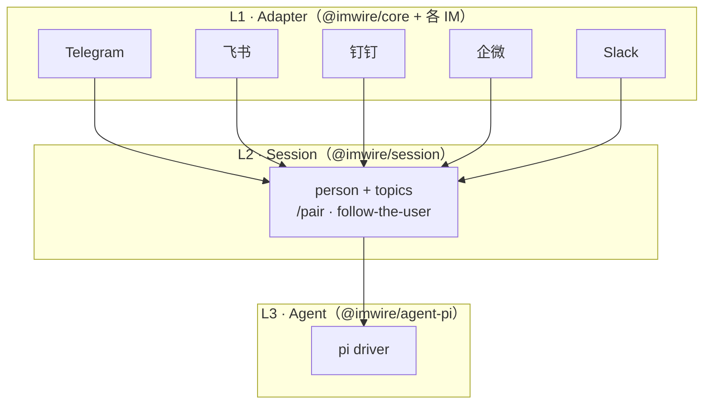

# imwire

One adapter interface for Feishu, DingTalk, WeCom, Telegram, and Slack. Long-connection first — no public IP required. Built for agents: streaming replies, approval buttons, and a person-scoped session layer that keeps one conversation as you switch IMs.

L1 (`@imwire/core` + platform adapters) does not know about people or sessions and stays independently usable. L2 (`@imwire/session`) sits on top of the adapter interface. L3 (`@imwire/agent-pi`) is one `AgentDriver` implementation; ACP drivers can be added later.

Packages are **ESM-only** (Node 20+). The npm name `imwire` is the `imwire serve` CLI (JSON-RPC over stdio / WebSocket). Import the SDK as `@imwire/core`. A thin PyPI client (`imwire`) talks to that process.

Wiring a real bot to pi: follow [`INSTALL.md`](INSTALL.md) (credentials, env, verify, errors).

## 30 秒看懂 imwire

三层，从上到下互不倒依赖：L1 只说话，L2 认得「人」，L3 才是模型。



和 OpenClaw 这类「一个 IM 频道一段会话」的模型不同：imwire **不强制**把 Telegram / 飞书 / 钉钉拆成互不相干的 context。`/pair` 把同一人的多个账号链到一个 person 上，默认话题和 `/topic name` 在所有已绑定 IM 上共享；群聊仍然隔离。L1 可以单独引用，不依赖 L2/L3。

## Quickstart

```bash
pnpm install
pnpm build
cp .env.example .env
# fill TELEGRAM_BOT_TOKEN and/or FEISHU_APP_ID + FEISHU_APP_SECRET
pnpm --filter @imwire/example-echo start
```

The echo script is `node --env-file=../../.env dist/index.js` (Node ≥ 20.6). Copy `.env.example` first; without that file Node will refuse to start. You can also `export` the same variables yourself.

The echo example starts every adapter you configured, prints normalized inbound events, streams the reply back, and attaches Approve / Deny buttons. The assistant example wires Telegram + Feishu through `@imwire/session` and `@imwire/agent-pi` (env-config only):

```bash
# same .env; TELEGRAM_ACCOUNT_ID=mybot and IMWIRE_ALLOWLIST=telegram:mybot:<your user id>,Owner
pnpm --filter @imwire/example-assistant start
```

Owner bootstrap is the allowlist. From a linked IM send `/pair`, then paste the 8-digit code into the bot on a new IM. `/topic name` and `/topics` switch a named conversation across every linked IM. Group chats stay isolated. `/stop` cancels the in-flight turn.

```ts
import { TelegramAdapter } from "@imwire/telegram";
import { FeishuAdapter } from "@imwire/feishu";
import type { Adapter, Inbound } from "@imwire/core";

function attach(adapter: Adapter) {
  adapter.on(async (event: Inbound) => {
    if (event.type !== "message") return;
    const draft = await adapter.draft(event.chat, {
      replyTo: { chat: event.chat, messageId: event.messageId },
    });
    draft.append(event.text);
    await draft.finalize({
      blocks: [
        { kind: "markdown", text: event.text },
        {
          kind: "buttons",
          buttons: [
            { id: "approve", label: "Approve", style: "primary", value: "ok" },
            { id: "deny", label: "Deny", style: "danger" },
          ],
        },
      ],
    });
  });
}
```

Config is env vars only. Never commit tokens.

`on()` handlers are dispatched off the transport loop (per-chat ordered queue for messages; actions / edits / reactions run in parallel so an approval-awaiting handler still receives the click). Feishu card callbacks are acked immediately (3 s deadline).

## Packages

| Package | Role |
|---|---|
| `@imwire/core` | Normalized events, `Adapter`, capability table, dedup, rate limit, retry, reconnect, chunking, streaming-draft degrade. |
| `@imwire/telegram` | Bot API long polling (`getUpdates`), edits, inline keyboards, typing, stream-via-`editMessageText` |
| `@imwire/feishu` | Official `@larksuiteoapi/node-sdk` WebSocket long connection, Card JSON 2.0, CardKit streaming with patch fallback |
| `@imwire/dingtalk` | Stream mode (raw WS, same topics as `dingtalk-stream`): robot `/v1.0/im/bot/messages/get`, AI card `PUT /v1.0/card/streaming`, card callbacks, `editScope: cards` |
| `@imwire/wecom` | 智能机器人 long-connection (`wss://openws.work.weixin.qq.com`). Stream replies via `aibot_respond_msg` + inbound `req_id`. `proactiveSend: false` (never `aibot_send_msg`). Reply `req_id` kept 24h in a 1 MiB LRU (`WECOM_REPLY_STORE` optional persist) |
| `@imwire/slack` | Socket Mode (raw WS via `apps.connections.open`), Block Kit buttons, `chat.update` streaming, threads (`thread_ts`) |
| `imwire` | `imwire serve` CLI — JSON-RPC 2.0 over stdio and optional authenticated WebSocket (`IMWIRE_ADAPTERS` / `--adapter` required; leftover tokens are ignored). Spec: [`docs/protocol.md`](docs/protocol.md) |
| `imwire` (PyPI) | Thin async client (`python/`) for serve over stdio / WS, typed dataclasses. Example: `python/examples/echo.py` |
| `@imwire/session` | Person identities, hashed 8-digit `/pair` codes (per-sender lockout + per-code burn, never a global revoke), default + named topics, group isolation, follow-the-user routing, mid-stream switch, first-click-wins + authorized + TTL approvals. SQLite WAL + `busy_timeout` (better-sqlite3, or `node:sqlite` on Node 22+). Depends only on `@imwire/core`. |
| `@imwire/agent-pi` | `AgentDriver` over `@earendil-works/pi-agent-core` + `@earendil-works/pi-ai` 1.1.0. One Agent per conversation; log → pi `Message` shapes; live `text_delta` streaming; `beforeToolCall` → imwire approvals. Tests use pi-ai `fauxProvider` (no network). |
| `@imwire/example-echo` | Starts every adapter you configured |
| `@imwire/example-assistant` | Telegram + Feishu + session + pi, env-config only |

`@imwire/core/testing` imports `vitest` at runtime; vitest is an optional peer dependency of `@imwire/core`.

## Capability table

| | Telegram | Feishu | DingTalk | WeCom | Slack |
|---|---|---|---|---|---|
| Connection (v0) | long polling | WebSocket | Stream (raw WS) | 智能机器人 long-conn | Socket Mode (raw WS) |
| `streaming` | `edit` | `card` | `card` (AI card `PUT /v1.0/card/streaming`) | `card` (`aibot_respond_msg` stream `{id,finish,content}`) | `edit` (`chat.update`) |
| `streamingCard` | no | yes | yes | yes | no (`chat.startStream` exists in Slack docs; **unverified**, not used) |
| `buttons` | inline keyboard | Card JSON 2.0 button + `behaviors.callback` | AI card / Stream `/v1.0/card/instances/callback` | template_card `button_interaction` / `aibot_event_callback` | Block Kit `block_actions` |
| `edit` / `editScope` | yes / `any` | yes / `cards` — `PATCH /im/v1/messages` only accepts interactive cards, so `send()` always uses cards. (`editTextMessages` was folded into `editScope`.) | yes / `cards` (streaming + card instance) | yes / `cards` (`aibot_respond_update_msg`) | yes / `any` (`chat.update`) |
| `proactiveSend` | yes | yes | yes (sessionWebhook + robot oTo/group send) | **false** — reply-only via inbound `req_id` + `aibot_respond_msg` (docs also have `aibot_send_msg`; we do not call it). 24h `req_id` LRU (1 MiB, optional `WECOM_REPLY_STORE`) | yes |
| `delete` | yes | yes | no | no | yes (`chat.delete`) |
| `threads` | forum topics (`is_topic_message`) | `thread_id` / reply | no | no | yes (`thread_ts`) |
| `typing` | `sendChatAction` | no | no | no | no |
| `media` | not implemented (`false`) | not implemented (`false`) | no | no | no |
| `maxTextLength` | 4096 | 8000 (card body also clipped to 30 KB) | 5000 | 4096 | 40000 |
| `markdown` | `none` (no `parse_mode`; `**x**` is literal) | `subset` (card `markdown` tag) | `subset` | `subset` | `subset` (`mrkdwn`) |
| Live platform | fixture + optional live token | fixture + optional live token | **fixture-only** — Stream / AI card / sessionWebhook **not verified** against a real org | **fixture-only** — aibot WS **not verified** against a real corp | **fixture-only** — Socket Mode / Block Kit / `chat.update` **not verified** against a real workspace |

Streaming drafts degrade automatically: card update when the platform can, otherwise edit-in-place, otherwise buffered chunked sends. Stream updates are latest-wins coalesced (one in-flight + one pending) and skip unchanged text.

`Button` is `{ id, label, style?, value? }` on every platform. Telegram callback_data is limited to 64 **bytes**; longer payloads (including CJK ids) are hashed (`h:<16 hex>`) into a bounded LRU plus a SQLite `telegram_callback` table so hashed clicks still resolve after a restart.

## Roadmap

- **Week 1** — L1 core + Telegram + Feishu, contract tests against recorded fixtures.
- **Week 2** — L2 session (`@imwire/session`) + L3 pi driver (`@imwire/agent-pi`). Pairing, one conversation per person, follow-the-user streaming and approvals. The IM layer does not import the session package.
- **Week 3 (this PR)** — DingTalk Stream, WeCom 智能机器人 long connection, Slack Socket Mode, `imwire serve` (JSON-RPC stdio / WS), and the Python `imwire` client. Adapter tests are recorded fixtures cited against official docs; DingTalk / WeCom / Slack have **not** been verified against live platforms.

### Session commands and routing

| Command | Effect |
|---|---|
| `/pair` | Linked sender gets an 8-digit code (TTL 10 min, single use, rate-limited). Send the code to the bot from a new IM to link that account. |
| `/stop` | Cancel the in-flight turn and any pending approval wait. |
| `/topic name` | Create or switch to a named topic. Applies on every linked IM. `/topic default` returns to the personal default. |
| `/topics` | List topics; the active one is marked `→`. |

Unpaired senders get a short instruction and nothing else. Owner allowlist is `IMWIRE_ALLOWLIST=platform:accountId:userId[,name]`.

Replies go to the IM that triggered the turn. Proactive messages go to the person's most recently active IM. Concurrent inbound is a single ordered queue per conversation. If the user speaks from IM B while a reply is streaming on IM A, A is finalized with `→ continued in B`, the already-generated text is replayed on B, and the stream continues there. Pending approval cards follow the user; the first click wins and the other cards become `_handled_`.

## 中文

imwire 是给 agent 用的独立 IM SDK：一套 Adapter 接口接飞书 / 钉钉 / 企微 / Telegram / Slack，默认长连接，不需要公网 IP。面向 agent 的能力（流式回复、审批按钮、配对）是一等公民。L2 `@imwire/session` 让一个人在所有 IM 上共享一段对话；IM 层不依赖它，可以单独引用。`/pair` 出 8 位码，在新 IM 发给 bot 即完成绑定。群聊单独成会话，不会并进个人对话。中途换 IM 时，原侧草稿会标「continued in …」，已生成的文字在新侧续上。和 OpenClaw 的差别见上文「30 秒看懂 imwire」：会话按人合并，而不是按 IM 强制拆开。把机器人接到 pi 的逐步说明在 [`INSTALL.md`](INSTALL.md)。

核心包名是 `@imwire/core`。`imwire` 是 CLI（`imwire serve`，JSON-RPC，见 `docs/protocol.md`）；PyPI 上也有同名的薄客户端。包是 ESM-only。

钉钉 / 企微 / Slack 的适配器按官方文档做了夹具测试，**没有**在真实组织上跑过。企微按「只能回不能主动发」映射：`proactiveSend=false`，出站一律带回调里的 `req_id` 走 `aibot_respond_msg`。`req_id` 按文档保留 24 小时，内存 LRU 默认 1 MiB（可用 `WECOM_REPLY_STORE` 落盘）；预算满时会先丢过期项，再按 LRU 淘汰仍在窗口内的项。钉钉 AI 卡片流式上限 1 KB，超长文本的 Approve / Deny 打在最后一张卡片上。

```bash
pnpm install && pnpm build
cp .env.example .env   # echo 用 node --env-file 加载
# 在 .env 里填 TELEGRAM_BOT_TOKEN 或 FEISHU_APP_ID / FEISHU_APP_SECRET
pnpm --filter @imwire/example-echo start
```

飞书 `send()` 一律发交互卡片：飞书的 `PATCH` 只能改卡片，不能改普通文本（`editScope:"cards"`）。卡片用 Card JSON 2.0（按钮直接放在 `body.elements`，带 `behaviors.callback`，不要 `tag:action` / `wide_screen_mode`）。`element_id` 必须字母开头、≤20 字符、卡内唯一。

## Develop

```bash
pnpm install
pnpm typecheck
pnpm lint
pnpm test
```

CI (GitHub Actions) runs the same three commands on Node 20 and Node 22. Adapter tests use recorded fixtures and a fake transport. Session / pi tests use `FakeAdapter` plus pi-ai `fauxProvider` — no live Telegram, Feishu, or model network calls. On Node 20, `better-sqlite3` must compile (or install a prebuild); without a compiler the session package throws a clear error instead of `ERR_UNKNOWN_BUILTIN_MODULE`.

```bash
# acceptance demo (fake adapters): ask on TG, switch to Feishu mid-stream, approve on Feishu
pnpm exec vitest run packages/session/tests/demo.test.ts
# e2e against local HTTP/WS platform mocks (pairing, cross-IM context, approvals, streaming)
pnpm exec vitest run packages/e2e/tests
```
